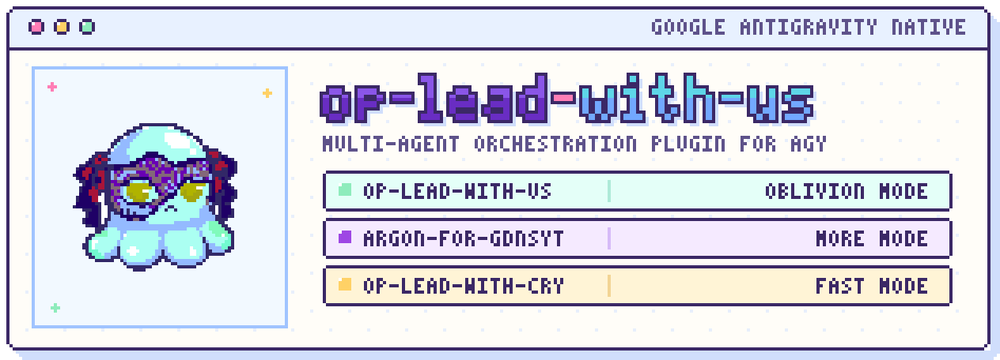

<p align="center">
  
</p>

<p align="center">
  <a href="#cn">简体中文</a> · <a href="#en">English</a>
</p>

<p align="center">
  <a href="https://antigravity.google"></a>
  
  
  <a href="LICENSE"></a>
  
</p>

<p align="center">
  <b><a href="#quick-start">Quick Start</a> · <a href="#core-modes">Core Architecture</a> · <a href="#roles">Roles</a> · <a href="#en">English</a> · <a href="#license">License</a></b>
</p>

---

<a id="cn"></a>

## 🇨🇳 简体中文

**`op-lead-with-us-native` (`0.7.0`)** 是一款 **100% 遵循 Antigravity 2.x 官方合规接口** 打造的原生多智能体编排插件。

本版本全面重构为基于原生 **`run_workflow`**、**决策模型权重门禁（System1 / 本地 Laya / OpenAI 兼容）**、**工单执行树（`T-xxxx`）+ 按需 Git Worktree 隔离** 与 **官方 MCP App 可视化界面** 的原生架构：**零未公开内部 LS RPC 调用、零 `agy acp` 包装脚本、零后台脱离会话轮询守护进程、零外部运行依赖（纯 Python 3.13 标准库）**。

---

<a id="core-modes"></a>

###  核心架构与特性一览

#### 1. `op-lead-with-us`（Native Super-Agent 全局路由器）+ 工单执行树 (`T-xxxx`)


> **核心理念：零中途打扰（Scheme A）· 自动结单（Scheme B）· 按需隔离不脏主工作区。**

在 Antigravity **Agents** 下拉框选择 **`op-lead-with-us`** 后，主会话作为 Tier 1 全局路由器单次触发 `workflows/orchestrate.py`，所有中间进度在原生工作流卡片内静默推进，最终仅返回一份结构化结果：

* **工单即执行树（Ticket Execution Tree）**：每次编排在 `<workspace>/.argon/tickets.json` 自动分配或续接 `T-0001` 根工单，并以 `Router -> Lead [T-xxxx] -> (Researcher / Implementer / Self-Repair / Gate / Reviewer [active|waived] / Close)` 树状拓扑留痕，同时自动注册至全局多项目索引 `projects.json`。
* **按需自适应 Git Worktree**：单文件微改动直接在主工作区极速落盘；多文件、复杂任务、`pipeline` 或 `parallel_branch` 在 `.argon/worktrees/T-xxxx`（分支 `argon/T-xxxx`）自动派生隔离 Worktree（镜像未提交业务文件）。校验通过且自动结单（`done`）时**无感同步回主工作区并清理临时 Worktree（绝不自动 `git commit`/`push`）**；存在合入冲突或待人工签字（`review`）时完整保留 Worktree 供面板一键预览、合入或丢弃。

```text
                       [ 主会话 Router (op-lead-with-us) ]
                                      │ run_workflow(workflows/orchestrate.py)
                                      ▼
               ┌──────────────────────────────────────────────┐
               │        Lead Root [T-0001] (orchestrate.py)    │
               │   Checkpoint 1: 路由决策 (topology_weight)    │
               └──────────────────────┬───────────────────────┘
          ┌───────────────┬───────────┴───────────┬───────────────┐
          ▼               ▼                       ▼               ▼
     [⚡ Direct]   [🛠️ single_flash]     [🔍 pipeline]    [🌿 parallel_branch]
                                      Researcher → Impl   Sub-Worktrees → Integrate
                                              │
                                              ▼
                       [🛡️ Local Verifier + Scheme A 静默自修]
                                              │
                                              ▼
                 [⚖️ Checkpoint 3: 免审 & 自动结单 (w_waiver, w_close)]
                          ┌───────────────────┴───────────────────┐
                          ▼                                       ▼
           [🟢 DONE (Worktree 无感合入清理)]        [🟡 REVIEW (保留 Worktree 待审)]
```

<br clear="right" />

---

#### 2. 决策模型与双模态权重系统 (`DecisionWeights`)


> **无模型时 `{0, 1}` 确定性开关 · 有模型时 `[0.00, 1.00]` 连续阈值调制 · 硬护栏绝不绕过。**

接入 System1（`https://emrank.tech/v1/decisions`）、本地 **Laya** 或 OpenAI 兼容端点后，工作流在 **Route / Escalation / Quality Gate** 三个检查点受以下三项独立权重（及可选 **`linked_master` 一键总联动**）精准调制：

* **① 独立审核跳过权重 `review_waiver_weight`**：控制本地硬护栏 100% 通过后是否跳过 `agy-reviewer` 终审（在线按 $\tau_{\text{criteria}} = 0.92 - 0.42w$、$\tau_{\text{test}} = 0.88 - 0.42w$ 动态调节免审门槛；离线 `0`=必审、`1`=本地硬校验通过即免审）。
* **② 前置拓扑变更权重 `topology_weight`**：控制执行树是否从基础 `single_flash` 自动伸缩为 `pipeline`、`parallel_branch` 或 `direct`（离线 `0`=锁定 `single_flash`、`1`=启用启发式）。
* **③ 自动结单权重 `auto_close_weight`**：控制审核通过后是否直接原子合入 Worktree 并闭环为 `done`（`0`=全部停在 `review` 等待人工确认；`>0` 按风险等级与人工复核需求分数动态放行，冲突或显式 `require_human_review=true` 时强制人工确认）。

<br clear="right" />

---

#### 3. 官方 MCP App 可视化界面 (`Op Lead With Us` / `Op Lead Tree`)


* **双入口原生呈现**：由纯 Python 标准库编写的 `mcp/board_server.py` + 自包含单文件前端 `mcp/ui/app.html` 提供支持，符合 `default-src 'none'` CSP 规范与 Antigravity 主题变量。
* **多项目工单树 & 一键 Worktree 控制**：通过 Antigravity 左侧主边栏 **`Op Lead With Us`**（`global`）或右侧 `+` 辅助面板 **`Op Lead Tree`**（`aux_pane`）打开，随时切换活跃项目、在线调节权重滑块 / 离线 `0/1` 开关、点击节点文件直接调用侧栏预览，并一键 **合入主工作区并结单** 或 **丢弃待审 Worktree**。

<br clear="right" />

---

<a id="roles"></a>

###  角色与组件矩阵 (Roles & Components)

| 角色 / 组件 | 标识符 (Identifier) | 模型 / 运行时 | 职责与权限边界 |
| :--- | :--- | :--- | :--- |
|  **全局路由器 (Global Router)** | `op-lead-with-us` | 主会话选定模型 (`inherit`) | **Tier 1 主入口**。单次触发 `run_workflow`，零中途轮询，最终汇总 `ticket_id`、权重与 Worktree 状态。 |
|  **决策门禁与权重 (Decision Gate)** | `decision_client.py` | System1 / 本地 Laya / OpenAI | 执行三道检查点评分与双模态 `DecisionWeights` 归一化，Windows DPAPI 加密存储凭据。 |
|  **工单树看板 (MCP App)** | `open_lead_board` | Python 3.13 Stdlib MCP | 提供 `Op Lead With Us` (`global`) 与 `Op Lead Tree` (`aux_pane`) 面板，零上下文泄露。 |
|  **调研员 (Researcher)** | `agy-researcher` | **Gemini Flash** (`flash`) | 只读代码库探索、接口定位与并行拆包规划，严禁修改任何文件或递归调用 `run_workflow`。 |
|  **实现员 (Implementer)** | `agy-implementer` | **Gemini Flash** (`flash`) | 在指定工作区 / Worktree 与作用域内执行编辑、测试及 Scheme A 静默自修。 |
|  **审计员 (Reviewer)** | `agy-reviewer` | **Gemini Flash** (`flash`) | 离线默认或不确定带触发的只读独立终审，验证 Diff、结构校验与验收条件。 |

---

<a id="quick-start"></a>

###  快速开始 (Quick Start)

#### 1. 全局安装

克隆本仓库并安装至本地 Antigravity 插件目录 `~/.gemini/config/plugins/op-lead-with-us-native`（安装时自动探测本机 Antigravity 内置 Python 3.13 路径写入 `mcp_config.json`）：

```powershell
git clone https://github.com/planelin/op-lead-with-us.git
cd op-lead-with-us
python scripts/install-local.py
```

* **Windows 快捷安装 / 卸载**：直接双击仓库根目录下的 [`install.bat`](./install.bat) 即可一键安装；双击 [`uninstall.bat`](./uninstall.bat) 或运行 `python scripts/install-local.py --uninstall` 即可卸载。

#### 2. 配置决策模型与权重（可选，离线可用）

双击根目录 [`configure-decision.bat`](./configure-decision.bat) 打开中文交互菜单（`[1]` 配置 System1 / 本地 Laya / OpenAI 兼容端点，`[2]` 连通性诊断，`[5]` 配置三项权重与总联动），或使用命令行快捷设置：

```powershell
.\configure-decision.bat --url http://127.0.0.1:8000/v1/decisions --protocol systemone --model jev-latest --mode gate --diagnose
.\configure-decision.bat --review-waiver-weight 0.78 --topology-weight 0.50 --auto-close-weight 0.80
```

#### 3. 在 Antigravity 中使用 & 本地校验

1. 重启 **Antigravity 2.x**（或在 MCP Servers 设置中刷新插件）。
2. 新建对话，在 **Agents** 下拉选择 **`op-lead-with-us`**，直接提出工程开发或资产生成任务。
3. 在左侧主边栏点击 **`Op Lead With Us`** 或右侧 `+` 面板打开 **`Op Lead Tree`** 查看工单执行树、调节权重或一键合入 Worktree。
4. 运行本地合规校验与全量单元测试：

```powershell
python scripts/validate.py
python -m unittest discover -s tests -v
```

---
---

<a id="en"></a>

## 🌐 English

**`op-lead-with-us-native` (`0.7.0`)** is a **100% ToS-compliant** multi-agent orchestrator built strictly on official **Google Antigravity 2.x** surfaces (`run_workflow`, plugin `rules/`/`skills/`/`agents/`, and the official MCP App UI) with **zero external Python dependencies**.

---

###  Core Architecture

#### 1. `op-lead-with-us` (Tier 1 Global Router) & Ticket Execution Tree (`T-xxxx`)


> **Philosophy: Zero mid-flight noise (Scheme A), safe auto-close (Scheme B), and on-demand Git Worktree isolation.**

* **Single-Turn Global Router**: Selecting **`op-lead-with-us`** routes engineering deliverables straight into `run_workflow(ScriptPath="workflows/orchestrate.py")` with silent card progress and one crisp final report.
* **Ticket Execution Tree (`T-xxxx`)**: Every workflow allocates or continues a `T-0001` Lead root in `<workspace>/.argon/tickets.json` (`Router -> Lead -> Researcher / Implementer / Self-Repair / Gate / Reviewer [active|waived] / Close`) and registers the project in global `projects.json`.
* **Adaptive Git Worktree**: Single-file tweaks edit directly for speed; multi-file, complex, `pipeline`, or `parallel_branch` Git tasks isolate into `.argon/worktrees/T-xxxx` (`argon/T-xxxx`), mirror uncommitted dirty files, auto-merge back atomically on `done` without ever running `git commit`/`push`, or stay preserved in `review` on conflict/sign-off.

<br clear="right" />

#### 2. Decision Model & Dual-Mode `DecisionWeights`


* **Offline Binary `{0, 1}` vs Online Continuous `[0.00, 1.00]`**: Without an active Decision Model (`mode == "off"`), `review_waiver_weight`, `topology_weight`, and `auto_close_weight` snap deterministically to `{0, 1}`. With System1 (`emrank.tech`), local **Laya**, or an OpenAI-compatible endpoint online, all three weights (plus `linked_master` / `master_weight`) smoothly modulate waiver thresholds, topology scaling, and auto-close risk bounds while strictly respecting hard local verification invariants.

<br clear="right" />

#### 3. Official MCP App Panel (`Op Lead With Us` / `Op Lead Tree`)


* Built with pure Python 3.13 stdlib (`mcp/board_server.py`) and a self-contained single-file UI (`mcp/ui/app.html`) compliant with `default-src 'none'` CSP. Open **Op Lead With Us** from the left sidebar (`global`) or **Op Lead Tree** from the right `+` pane (`aux_pane`) to switch projects, inspect execution trees and 4D scores, open changed files in the side pane, tune weights live, and one-click merge or discard pending Worktrees.

<br clear="right" />

---

###  Installation & Verification

```powershell
git clone https://github.com/planelin/op-lead-with-us.git
cd op-lead-with-us
python scripts/install-local.py
```

* **Windows Batch Helpers**: Double-click [`install.bat`](./install.bat) to install globally, [`uninstall.bat`](./uninstall.bat) to uninstall, or [`configure-decision.bat`](./configure-decision.bat) to configure Decision Model endpoints & weights.
* **Validate & Test**:
  ```powershell
  python scripts/validate.py
  python -m unittest discover -s tests -v
  ```

---

<a id="license"></a>

## License

Distributed under the **MIT License**. See [`LICENSE`](LICENSE) for details.

<sub>社区与友链：[LINUX DO](https://linux.do)</sub>
