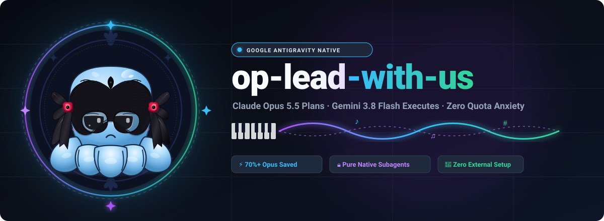
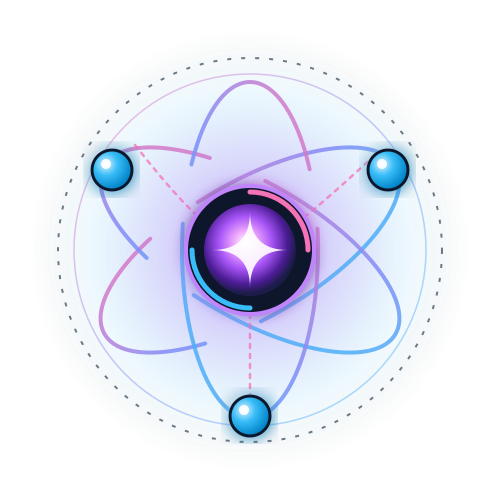

<p align="center">
  
</p>

<p align="center">
   <a href="#简体中文">简体中文 |<a href="#-english">English</a></a>
</p>

<p align="center">
  <a href="https://antigravity.google"></a>
  
  
  <a href="LICENSE"></a>
  
</p>


<p align="center">
  <b><a href="#quick-start">Quick Start</a> · <a href="#what--why">Why</a> · <a href="#roles">Roles</a> · <a href="#architecture">Architecture</a> · <a href="#license">License</a></b>
</p>

---

<a name="-简体中文"></a>

## 🇨🇳 简体中文

**`op-lead-with-us`** 是一款专为 Google Antigravity (`agy`) 打造的多智能体编排插件。

在最新版本中，插件全面升级为以 **Super-Agent 架构** 为核心的**「遗忘模式 (`op-lead-with-us`)」**，同时完整保留了经典的**「更多模式 (`argon-for-gdnsyt`)」**主从派发架构，满足从“多任务异步自治”到“高阶主模型配额精打细算”的不同开发场景。

---

### ✨ 核心模式一览

#### 1. `op-lead-with-us`（遗忘模式 / Oblivion Mode）—— 全新 Super-Agent 架构 🌟

<p align="left">
  
</p>

> **核心理念：解放人类注意力，忘掉繁琐的多窗口切换与上下文管理，使你不惧遗忘。**

传统单会话代理在面对复杂工程或多线任务时，往往受限于“主模型亲力亲为导致上下文腐化”以及“人类同时盯多个会话的心智极限”。**遗忘模式 (`op-lead-with-us`)** 引入了全新的 **Router + Ticket 工单状态机 + 跨会话隔离执行** 的 Super-Agent 架构：

* **注意力解耦与单窗口全局调度（Router 层）**：主入口仅负责意图识别、任务立项（Ticket）、状态追踪与向人类汇报关键决策点，**结构化剥离直接改写代码的权限**，彻底杜绝主窗口因长日志阻塞而降智。
* **持久化 Ticket 状态机与受控并发槽位**：任务以独立工单（`queued` / `working` / `waiting_human` / `completed` / `blocked`）持久化流转。通过并发槽位锁（`maxActive`）与人类回复优先槽位，让多个工单在后台有序推进，绝不打爆宿主机并发与速率限制。
* **跨会话派生与模型安全门禁（Lead & Worker 层）**：每个进入活跃状态的工单会自动派生/唤醒独立的顶层 Lead 会话（强制校验并锁定低成本 `Flash` 模型，内置熔断保护防止误烧高阶配额），再由该工单的 Lead 向下通过 `invoke_subagent` 调度专属的调研、实现与审计子代理。

```text
                       [ 人类开发者 (单一交互窗口) ]
                                    │
                                    ▼
             ┌─────────────────────────────────────────────┐
             │           op-lead-with-us (遗忘模式)         │
             │       Global Router & Ticket 状态机调度      │
             │   (意图收集 / 工单排队 / 槽位控制 / 熔断门禁)  │
             └──────────────────────┬──────────────────────┘
                                    │ 跨会话受控派生 (强制锁定 Flash)
                   ┌────────────────┴────────────────┐
                   ▼                                 ▼
       ┌───────────────────────┐         ┌───────────────────────┐
       │  Ticket #1 Lead 会话  │         │  Ticket #2 Lead 会话   │
       │(独立会话 & 隔离工作区) │         │  (独立会话 & 隔离工作区) │
       └───────────┬───────────┘         └───────────┬───────────┘
                   │ invoke_subagent                 │ invoke_subagent
         ┌─────────┼─────────┐             ┌─────────┼─────────┐
         ▼         ▼         ▼             ▼         ▼         ▼
      [调研员]  [实现员]  [审计员]        [调研员]  [实现员]  [审计员]
     (Research) (Implem)  (Review)     (Research) (Implem)  (Review)
```

---

#### 2. `argon-for-gdnsyt`（更多模式 / More Mode）—— 经典主从派发架构 🎯

<p align="left">
  
</p>

> 核心理念：**Argon for 更多你使用它**
> Огонь по готовности —— **“请随意开火吧！”。**

**`argon-for-gdnsyt`** 完整继承了旧版 `op-lead-with-us` 的经典 **Main Agent → Subagents** 架构。当你希望在单次会话中动用顶级推理模型（如 **Claude Opus 5.5** 或 **Gemini Argon**）亲自把控架构设计，但又不想让昂贵的配额浪费在翻找代码、反复改文件和跑单测上时，请选择此模式：

* **主脑专注决策，苦力全交 Flash**：主模型（`model: inherit`）仅负责需求定界、拆解 Task Packet、审查精简证据与最终验收；所有高消耗的代码库搜索、文件编辑、测试执行与自修复循环全部通过 `invoke_subagent` 卸载给后台的 **Gemini Flash** 子代理。
* **支持两阶段规划 (`PLAN_ONLY`)**：可先用高阶模型产出一份高密度 `PLAN.md`（≤120 行）后立即停机，再切回免费/充裕的 Flash 会话执行具体计划，做到高阶模型与测试日志物理零接触。
* **高压缩证据回传**：子代理报告严格限高（调研 ≤40 行 / 实现 ≤50 行 / 审计 ≤60 行），保持主会话上下文始终纯净如初。

```text
                             [ 用户需求输入 ]
                                    │
                                    ▼
             ┌─────────────────────────────────────────────┐
             │          argon-for-gdnsyt (更多模式)         │
             │        高阶主模型 (Opus / Argon / Pro)       │
             │         架构设计 · 任务拆解 · 最终验收         │
             └──────────────────────┬──────────────────────┘
                                    │ invoke_subagent
             ┌──────────────────────┼──────────────────────┐
             ▼                      ▼                      ▼
     [ agy-researcher ]    [ agy-implementer ]     [ agy-reviewer ]
       (Gemini Flash)        (Gemini Flash)         (Gemini Flash)
       只读代码库与文档调研     受控编辑与单测自修复      独立 Diff 与质量审计
```

---

#### 3. `op-lead-with-cry`（快模式 ）⚡

* **定位说明**：这是一个以**推进速度**为单一目标的辅助模式（需要浪费额度时可能用得上）。
* **运行方式**：手动将主会话选为 `Gemini Flash`，主动放弃对 Worker 调用次数的节制，通过依赖感知的任务拆解与多路 Flash 子代理并发扇出换取速度。适合配额充裕、追求快速平推的简单任务。

---

### 🧩 角色与模型矩阵 (Roles & Personas)

| 角色 / 模式 | 标识符 (Identifier) | 推荐模型配置 | 职责与权限边界 |
| :--- | :--- | :--- | :--- |
| **遗忘模式 (Super-Agent)** | `op-lead-with-us` | 用户手动选择主模型（L2lead与L3worker一般锁定flash模型） | **super-agent架构**。全局工单路由、持久化状态机管理、跨会话派生独立工单 Lead 并汇总交付。 |
| **更多模式 (Classic Lead)** | `argon-for-gdnsyt` | 用户手动选择主模型（推荐 **Opus / Argon**） | **经典架构**。单会话内由高阶模型担任总架构师，将脏活累活委派给 Flash 子代理，极致节省主模型配额。 |
| **快模式 (浪费模式)** | `op-lead-with-cry` | 手动选择 **Gemini Flash** (`model: flash`) | 速度优先的并发扇出调度模式，用更高的子代理调用消耗换取并行推进（辅助特性）。 |
| **调研员 (Researcher)** | `agy-researcher` | **Gemini Flash** (`flash`) | 只读代码库探索、依赖分析、接口定位与外部文档检索，严禁修改任何代码。 |
| **实现员 (Implementer)** | `agy-implementer` | **Gemini Flash** (`flash`) | 在限定文件与预算内执行代码编写、运行测试与自修复（支持分支/目录隔离）。 |
| **审计员 (Reviewer)** | `agy-reviewer` | **Gemini Flash** (`flash`) | 独立审查 Git Diff、测试结果与验收标准匹配度，提供客观放行或驳回结论，只读无写权限。 |

---

### 🚀 快速开始 (Quick Start)

#### 1. 全局安装

克隆本仓库并安装至本地 Antigravity 用户配置目录：

```powershell
git clone https://github.com/planelin/op-lead-with-us.git
cd op-lead-with-us
npm run install:global
```

*(如需卸载：`npm run uninstall:global`)*

* **Windows 快捷安装**：直接双击运行仓库根目录下的 [`install.bat`](./install.bat)（需 Node.js 18+）；运行 `install.bat uninstall` 即可一键卸载。

#### 2. 在 Antigravity 中使用

1. 启动或重启 **Antigravity 2.0+**。
2. 新建对话（`Ctrl+N`）。
3. 根据你的场景选择对应 Agent：
   * 选择 **`op-lead-with-us`（遗忘模式）**：开启 Super-Agent 多工单自治工作流，轻松托管复杂与多线任务。
   * 选择 **`argon-for-gdnsyt`（更多模式）**：手动将主会话模型切换为 **Claude Opus 5.5** 或 **Argon**，享受高阶规划 + Flash 苦力的省配额体验。
   * *(可选)* 选择 **`op-lead-with-cry`（快模式）**：手动选择 **Gemini Flash** 进行多路并发平推。

---
---

<a name="-english"></a>

## 🌐 English

**`op-lead-with-us`** is a next-generation multi-agent orchestration plugin built for **Google Antigravity (`agy`)**.

In the latest release, the plugin introduces a brand-new **Super-Agent Architecture** under **Oblivion Mode (`op-lead-with-us`)** to eliminate human attention bottlenecks, while preserving the battle-tested **More Mode (`argon-for-gdnsyt`)** for classic main-agent-to-subagent quota optimization.

---

### ✨ Core Modes

#### 1. `op-lead-with-us` (Oblivion Mode) — Super-Agent Architecture 🌟

> **Philosophy: Free up human attention. Forget session juggling and context pollution.**

Traditional single-session agents often suffer from context rot (when the main agent tries to write code and read long test logs itself) and human attention overload (tracking multiple tabs). **Oblivion Mode (`op-lead-with-us`)** implements an autonomous **Router + Ticket State Machine + Isolated Lead Spawning** architecture:

* **Attention-Decoupled Global Router**: The primary session acts strictly as an intake router and ticket coordinator. Direct code-editing tools are structurally stripped from the router so your main window stays responsive at all times.
* **Durable Ticket Lifecycle & Slot Control**: Tasks are tracked as stateful tickets (`queued`, `working`, `waiting_human`, `completed`, `blocked`) with strict active-slot concurrency caps (`maxActive`) and priority human-reply slots.
* **Cross-Session Spawning & Model Guardrails**: Each active ticket spawns or resumes an isolated top-level Lead session (enforced with runtime **Flash** model verification and circuit-breaker protection so high-tier quotas are never accidentally drained in the background), which in turn orchestrates `agy-researcher`, `agy-implementer`, and `agy-reviewer` via `invoke_subagent`.

#### 2. `argon-for-gdnsyt` (More Mode) — Classic Main + Subagents Architecture 🎯

> **Philosophy: Save your frontier model quota so there is *more* of it for you to use.**

**`argon-for-gdnsyt`** preserves the classic `op-lead-with-us` workflow. When you want a frontier reasoning model (**Claude Opus 5.5** or **Gemini Argon / Pro**) to lead architecture and acceptance in a single session without burning quota on file searches and test loops:

* **Frontier Brain, Flash Muscle**: The main model (`model: inherit`) frames requirements, dispatches task packets, and makes acceptance decisions. Heavy repository exploration, code edits, and unit test repairs are offloaded to **Gemini Flash** subagents via native `invoke_subagent`.
* **Two-Phase Planning (`PLAN_ONLY`)**: Generate a compact `PLAN.md` (≤120 lines) with Opus/Argon and stop immediately, then execute the plan in a fresh Flash conversation.
* **Compressed Evidence**: Worker reports are strictly capped (researcher ≤40 / implementer ≤50 / reviewer ≤60 lines) to keep the main context crystal clear.

#### 3. `op-lead-with-cry` (Turbo / Wasteful Mode) ⚡

* **Overview**: A secondary, speed-first mode where the user manually selects **Gemini Flash** as the main model and opts into higher worker consumption for aggressive concurrent fan-out across independent tasks.

---

### 🛠️ Installation & Usage

```powershell
git clone https://github.com/planelin/op-lead-with-us.git
cd op-lead-with-us
npm run install:global
```

* **Windows Users**: Double-click [`install.bat`](./install.bat) to install globally, or run `install.bat uninstall` to remove.
* **In Antigravity**: Start a new conversation (`Ctrl+N`), pick **`op-lead-with-us`** (Oblivion Mode / Super-Agent) or **`argon-for-gdnsyt`** (More Mode / Classic Quota Saver), and send your request.

---

## 📄 License

Released under the [MIT License](./LICENSE).
