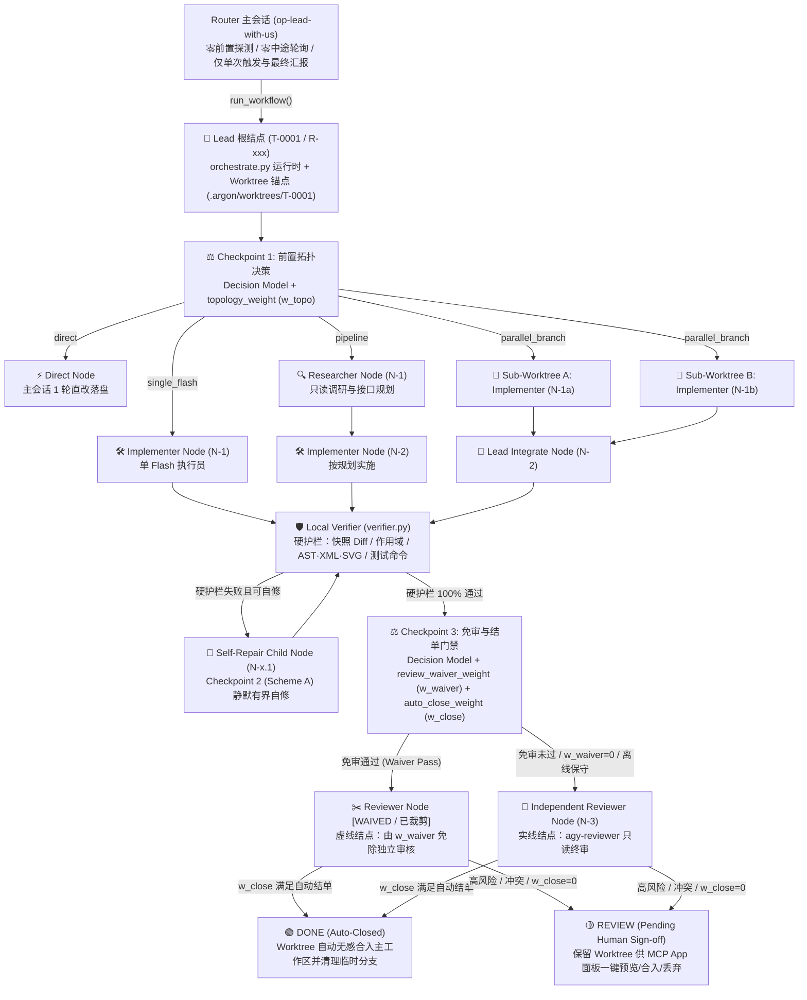

# `op-lead-with-us-native` (`0.7.0`) 进阶蓝图：工单执行树（Git Worktree）+ 决策权重系统 + 官方 MCP App 可视化界面

- **日期**：2026-11-21（Asia/Hong_Kong）
- **状态**：已确认设计蓝图（供后续实施会话直接按清单落地；本轮仅输出蓝图，不改动线上运行代码）
- **基线版本**：`op-lead-with-us-native` `0.7.0` MVP（`c:\Agents\antigravity\op-lead-with-us-native`，18 项核心文件、21 项单测通过、0 合规违规）
- **前序参考**：`0.6.0` 蓝图 [UPGRADE-PLAN-0.6.0.md](file:///C:/Agents/antigravity/op-lead-with-us/docs/UPGRADE-PLAN-0.6.0.md)、迁移与合规实证会话 [2cf46cd2](conversation://2cf46cd2-5745-4a5f-8a6e-22ab3e170ea7)、原生闭环验证会话 [9f6aaa1b](conversation://9f6aaa1b-d7ab-49ad-a0be-026a9b44e59c)

---

## 1. 核心目标与已确认设计决策

1. **过程与接口 100% 官方合规（零封禁风险底线）**：
   - 严格遵循 Google AI 开发者论坛 Antigravity 版块（https://discuss.ai.google.dev/c/antigravity/64）官方口径（ToS Section 6 & FAQ、`#131424`、`#187241`、`#200781`、`#186139`）：
     - **严禁**调用未公开的内部 Language Server RPC（`/exa.language_server_pb.LanguageServerService/*`）或读取内部 CSRF Token；
     - **严禁**在外层用第三方/自定义脚本包装 `agy` 或 `agy acp` 驱动个人 OAuth 会话；
     - **严禁**启动脱离会话生命周期的后台无人值守轮询守护进程（如旧版 `ticket-worker.mjs`）；
     - 仅使用 Antigravity 2.x 官方公开扩展原语：**`run_workflow`**、**`plugin.json`（`rules/`、`skills/`、`agents/`）**、**官方 MCP App（`mcp_config.json` + `ui://` 资源 + `aux_pane`/`global` 入口）**，以及单向 HTTP 调用用户自有凭据的决策模型（`emrank.tech` 或本地 Loopback **Laya**）。
2. **决策权重系统（无模型时 `{0, 1}` 二值确定性开关 vs 有模型时 `[0.00, 1.00]` 连续阈值调制）**：
   - **已确认（A1）**：采用 **“三项独立可调 + 一键总联动”**：
     1. **独立审核跳过权重 `review_waiver_weight`**：控制末端是否裁剪独立 `agy-reviewer` 结点；
     2. **前置拓扑变更权重 `topology_weight`**：控制前置执行树是否从基础 `single_flash` 自动伸缩为 `pipeline`（先调研后实施）、`parallel_branch`（多分支并行）或 `direct`；
     3. **自动结单权重 `auto_close_weight`**（承接 `0.6.0` 最末轮核心升级）：控制质量门禁通过后是否直接自动合入并闭环为 `done`（免人工敲 `验收`）。
   - **二值/连续双模态规则**：
     - **当无决策模型工作时（`mode == "off"` 或未配置/离线）**：每项权重仅允许取 **`0` (`false`)** 或 **`1` (`true`)**；
     - **当有决策模型工作时（`mode == "gate"`）**：每项权重可取 **`0.00 ~ 1.00`** 任意连续值（如 `0.78` 比 `0.20` 更易触发免除独立 Reviewer、拓扑升维与自动结单）；同时面板提供 **「一键总联动滑块 (`master_weight`)」**。
3. **工单即树（Ticket Execution Tree）+ 按需自适应 Git Worktree**：
   - **已确认（A2）**：恢复 `T-0001`、`T-0002` 工单标识，但不再是扁平列表，而是**以 `Router` 派生的 `Lead` 为根结点的有向执行树**，后续调研、实施、静默自修、并行拆包、免审裁剪、自动结单或人工续问（Continuation）全部作为 `Lead` 树上的子结点生长。
   - **按需自适应 Git Worktree**：单文件/微改动默认在主工作区 `inherit` 直改以保极速；多文件、并行分叉（`parallel_branch`）、高风险或显式指定隔离时，在 `<workspace>/.argon/worktrees/T-xxxx`（分支 `argon/T-xxxx`）派生独立 Worktree。**自动结单（`done`）时无感将改动同步回主工作区并清理临时 Worktree；待审（`review`）时保留 Worktree 供可视化面板一键预览 Diff、一键合入或丢弃**，实现真正的“零用户注意力消耗”。
4. **方案一（官方 MCP App）多项目工单树与权重可视化面板**：
   - 通过纯 Python 3.13 标准库实现的 stdio MCP Server（`mcp/board_server.py`）+ 单文件内联前端（`mcp/ui/app.html`），在 Antigravity **左侧主边栏全屏页（`global`）** 与 **右侧辅助面板（`aux_pane`，对标官方 `Swarm` 面板）** 同时呈现跨项目工单树拓扑、Worktree 合入控制与决策权重滑块。

---

## 2. 总体架构与执行树拓扑图



---

## 3. 模块一：决策权重系统详细规范（`decision_client.py` & `configure-decision.py`）

### 3.1 配置文件 Schema 扩展（`~/.gemini/antigravity/argon-system1/config.json`）

在现有 `schema: 1` 的 `config.json` 中新增 `weights` 对象（向后兼容：缺失时自动填充默认值）：

```json
{
  "schema": 1,
  "mode": "gate",
  "protocol": "systemone",
  "api_url": "https://emrank.tech/v1/decisions",
  "request_model": "cloudflare/clef",
  "credential_ref": "systemone-xxxxxxxx",
  "allow_unauthenticated_loopback": false,
  "weights": {
    "linked_master": false,
    "master_weight": 0.65,
    "review_waiver_weight": 0.65,
    "topology_weight": 0.50,
    "auto_close_weight": 0.75
  }
}
```

### 3.2 双模态归一化规则（`normalize_effective_weights`）

定义在 `workflows/lib/decision_client.py` 中的 `DecisionWeights` 数据类：

1. **当 `DecisionClient.enabled == False`（无决策模型 / `mode == "off"` / 未配置端点）**：
   - 所有权重强制量化为二值集合 **`{0.0, 1.0}`**（若配置文件中存有 `0~1` 小数，离线生效值按 `1.0 if val >= 0.5 else 0.0` 吸附；在 UI 和 `configure-decision.bat` 离线模式下仅允许输入 `0` 或 `1`）。
   - **离线默认值**（当用户尚未手动设定 `weights` 时）：
     - `review_waiver_weight = 0.0`（`false`：无决策模型时默认**不跳过**独立审核，`agy-reviewer` 必然启动）；
     - `topology_weight = 0.0`（`false`：无决策模型时默认**不自动改变架构**，固定走标准 `single_flash` 执行树）；
     - `auto_close_weight = 1.0`（`true`：当本地校验 + `agy-reviewer` 审核通过后，默认自动结单为 `done`）。
2. **当 `DecisionClient.enabled == True`（有决策模型 / `mode == "gate"`）**：
   - 所有权重取值范围为连续区间 **`[0.00, 1.00]`**（保留两位小数）。
   - 若 `linked_master == True`，三项权重统一取 `master_weight` 的值。

### 3.3 三项权重在 Checkpoint 1 & Checkpoint 3 的精确数学公式

> [!IMPORTANT]
> **硬护栏优先原则（Hard Guardrail Invariant）**：在 Checkpoint 3 中，若 `verifier.py` 检测到 `out_of_scope_count > 0`、`failed_command_count > 0` 或 `failed_artifact_count > 0`，无论 `review_waiver_weight` 或 `auto_close_weight` 设为多少（哪怕是 `1.0`），一律强制判定 `quality_verdict = "fail_repairable"`、`auto_close = False`，绝不允许绕过事实校验。

#### (1) 独立审核跳过权重：`review_waiver_weight` ($w_{\text{waiver}} \in [0, 1]$)
在本地硬护栏 100% 通过的前提下，决定是否裁剪 `agy-reviewer` 独立审核结点：

- **离线模式（`enabled == False`，$w_{\text{waiver}} \in \{0, 1\}$）**：
  - $w_{\text{waiver}} = 0$：`needs_flash_reviewer = True`，`quality_verdict = "unable"`（必然启动 `agy-reviewer`）。
  - $w_{\text{waiver}} = 1$：`needs_flash_reviewer = False`，`quality_verdict = "pass"`（直接免除 `agy-reviewer`，树图上 `Reviewer` 结点标记为 `waived`）。
- **在线决策模型模式（`enabled == True`，$w_{\text{waiver}} \in [0.00, 1.00]$）**：
  - 边界一致性：
    - 当 $w_{\text{waiver}} == 0.00$ 时：即使决策模型打高分，也强制 `needs_flash_reviewer = True`（100% 启动独立 `agy-reviewer` 复核）。
    - 当 $w_{\text{waiver}} == 1.00$ 时：只要未触发 `fail_repairable` 底线（`criteria_ok >= 0.50` 且 `test_ok >= 0.50`），强制 `needs_flash_reviewer = False`（100% 跳过独立 `agy-reviewer`）。
  - 连续区间 $0 < w_{\text{waiver}} < 1$ 的动态免审门槛公式：
    $$\tau_{\text{criteria}}(w_{\text{waiver}}) = 0.92 - 0.42\,w_{\text{waiver}}$$
    $$\tau_{\text{test}}(w_{\text{waiver}}) = 0.88 - 0.42\,w_{\text{waiver}}$$
    - 若 `criteria_ok < 0.50` 或 `test_ok < 0.45`：直接判 `fail_repairable`（先交回原 Implementer 静默自修，不浪费 Reviewer）；
    - 若 `criteria_ok >= \tau_criteria` 且 `test_ok >= \tau_test`：判 **`pass` 且 `needs_flash_reviewer = False`**（成功跳过独立 Reviewer，例如 $w=0.78$ 时门槛仅为 `0.592 / 0.552`，比 $w=0.20$ 时的 `0.836 / 0.796` 大幅更容易触发免审）；
    - 若落在中间不确定带（`[0.50, \tau]`）：判 `unable` 且 **`needs_flash_reviewer = True`**（召唤独立 `agy-reviewer` 终审）。

#### (2) 前置拓扑变更权重：`topology_weight` ($w_{\text{topo}} \in [0, 1]$)
在 Checkpoint 1 决定 `Lead` 根结点下的执行树形态（`single_flash` 基础形态 vs `pipeline` / `parallel_branch` / `direct` 架构变更）：

- **离线模式（`enabled == False`，$w_{\text{topo}} \in \{0, 1\}$）**：
  - $w_{\text{topo}} = 0$：**锁定基础架构**，固定返回 `route = "single_flash"`（不自动拆分为 `pipeline` 或 `parallel_branch`）。
  - $w_{\text{topo}} = 1$：启用 `_heuristic_route` 启发式规则，允许根据关键词与文件数自动切换为 `pipeline`、`parallel_branch` 或 `direct`。
- **在线决策模型模式（`enabled == True`，$w_{\text{topo}} \in [0.00, 1.00]$）**：
  - 当 $w_{\text{topo}} == 0.00$ 时：强制锁定 `route = "single_flash"`（除非调用方显式传了 `route_override`）。
  - 当 $0 < w_{\text{topo}} \le 1.00$ 时：对非默认拓扑的原始适应度分数施加权重增益，并动态调节切换门槛：
    $$\text{effective\_score}(r) = \begin{cases} \text{raw\_score}(r), & r = \text{single\_flash} \\ \text{raw\_score}(r) \times (0.50 + 0.80\,w_{\text{topo}}), & r \in \{\text{pipeline}, \text{parallel\_branch}, \text{direct}\} \end{cases}$$
    $$\tau_{\text{parallel}}(w_{\text{topo}}) = 0.85 - 0.30\,w_{\text{topo}}, \qquad \tau_{\text{direct}}(w_{\text{topo}}) = 0.85 - 0.25\,w_{\text{topo}}$$
    - $w_{\text{topo}}$ 越高（如 `0.78`），越容易在多模块任务上自动展开 `Researcher -> Implementer` 流水线或 `parallel_branch` 并行子 Worktree；$w_{\text{topo}}$ 越低（如 `0.20`），越倾向于保持最稳妥的单 `Implementer` 树结构。

#### (3) 自动结单权重：`auto_close_weight` ($w_{\text{close}} \in [0, 1]$)
在 Checkpoint 3（或 `agy-reviewer` 终审）得出 `quality_verdict == "pass"` 后，决定是否直接将工单树闭环为 `status = "done"`（并自动合入 Worktree）：

- **强制人工审核硬条件**（以下任一为真时，无论 $w_{\text{close}}$ 为何值，`auto_close` 均为 `False`）：
  1. 用户显式传入 `require_human_review = True`；
  2. Worktree 自动合入预检发现主工作区存在**文件级合入冲突**（`worktree_merge_conflict == True`）；
  3. `quality_verdict != "pass"`。
- **离线模式（`enabled == False`，$w_{\text{close}} \in \{0, 1\}$）**：
  - $w_{\text{close}} = 0$：`auto_close = False`，工单停在 `status = "review"`，等待人工在面板点击确认。
  - $w_{\text{close}} = 1$：只要 `quality_verdict == "pass"` 且 `change_risk <= 3`，`auto_close = True`，直接自动合入 Worktree 并结单为 `done`。
- **在线决策模型模式（`enabled == True`，$w_{\text{close}} \in [0.00, 1.00]$）**：
  - 当 $w_{\text{close}} == 0.00$ 时：强制 `auto_close = False`（全部停在 `review`）。
  - 当 $w_{\text{close}} == 1.00$ 时：只要 `quality_verdict == "pass"` 且 `change_risk <= 4`，强制 `auto_close = True`。
  - 当 $0 < w_{\text{close}} < 1$ 时：动态计算允许自动结单的 `human_review_needed` 容忍上限与最大风险等级：
    $$\tau_{\text{human}}(w_{\text{close}}) = 0.15 + 0.65\,w_{\text{close}}$$
    $$\text{max\_auto\_risk}(w_{\text{close}}) = \begin{cases} 1, & w_{\text{close}} < 0.25 \\ 2, & 0.25 \le w_{\text{close}} < 0.50 \\ 3, & 0.50 \le w_{\text{close}} < 0.85 \\ 4, & w_{\text{close}} \ge 0.85 \end{cases}$$
    当 `human_review_needed <= \tau_human` 且 `change_risk <= max_auto_risk` 时，`auto_close = True`（直接结单为 `done`）。

---

## 4. 模块二：工单执行树（Ticket Tree）与按需自适应 Git Worktree 规范

### 4.1 跨项目与工单树存储结构

1. **全局项目注册表 `~/.gemini/antigravity/argon-system1/projects.json`**：
   - 每次 `orchestrate.py` 在某个 `workspace` 运行时，自动将该 `workspace` 绝对路径、项目名、最近运行时间与工单计数原子更新到 `projects.json`（上限 30 个项目，按活跃时间排序），使全局 MCP App 界面无需手动配置即可列出本机所有活跃项目。
2. **项目内工单树索引 `<workspace>/.argon/tickets.json`**：
   - 维护递增工单号 `next_seq`（生成 `T-0001`, `T-0002`, ...）与最近 50 张工单树的摘要及完整树结点拓扑 `tree`（详细运行证据仍保存在 `<workspace>/.argon/runs/R-*.json`，并通过 `run_id` 双向关联）。
3. **工单执行树 JSON 结构（`TicketTree` Schema）**：
   ```json
   {
     "ticket_id": "T-0001",
     "latest_run_id": "R-20261121T070000Z-a1b2c3",
     "workspace": "C:\\Agents\\antigravity\\testop",
     "task": "建立会话专属文件夹并生成 SVG 动画",
     "status": "done",
     "route": "single_flash",
     "isolation": {
       "mode": "worktree",
       "branch": "argon/T-0001",
       "worktree_path": "C:\\Agents\\antigravity\\testop\\.argon\\worktrees\\T-0001",
       "merge_status": "merged_and_cleaned"
     },
     "applied_weights": {
       "decision_enabled": true,
       "review_waiver_weight": 0.78,
       "topology_weight": 0.50,
       "auto_close_weight": 0.78
     },
     "root_node_id": "N-lead",
     "nodes": [
       {
         "id": "N-router",
         "parent_id": null,
         "kind": "router",
         "title": "Router (op-lead-with-us)",
         "status": "done",
         "detail": "Spawned Lead root T-0001"
       },
       {
         "id": "N-lead",
         "parent_id": "N-router",
         "kind": "lead",
         "title": "Lead Root [T-0001]",
         "status": "done",
         "worktree": "argon/T-0001",
         "detail": "Checkpoint 1 selected single_flash (complexity=3/5, w_topo=0.50)"
       },
       {
         "id": "N-impl-1",
         "parent_id": "N-lead",
         "kind": "implementer",
         "title": "Flash Implementer",
         "status": "done",
         "conversation_id": "7b6bd524-be13-4266-8a14-cf514c0b8354",
         "changed_files": ["session-9f6aaa1b/bouncing-ball.svg"]
       },
       {
         "id": "N-gate",
         "parent_id": "N-impl-1",
         "kind": "gate",
         "title": "Verifier & Decision Gate",
         "status": "done",
         "scores": {"test_verified": 0.90, "criteria_met": 0.92, "human_review_needed": 0.02, "change_risk": 2}
       },
       {
         "id": "N-reviewer",
         "parent_id": "N-gate",
         "kind": "reviewer",
         "title": "Independent Reviewer",
         "status": "waived",
         "detail": "Waived by Decision Model (w_waiver=0.78, threshold=0.59/0.55)"
       },
       {
         "id": "N-close",
         "parent_id": "N-gate",
         "kind": "close",
         "title": "Auto-Close & Worktree Merge",
         "status": "done",
         "detail": "Auto-closed to done (w_close=0.78)"
       }
     ]
   }
   ```

### 4.2 按需自适应 Git Worktree 管理器（`workflows/lib/worktree_manager.py`）

新增纯标准库模块 `workflows/lib/worktree_manager.py`，负责 `Lead` 根结点的按需 Worktree 派生、同步与回收：

1. **自适应触发判定 `should_use_worktree(workspace, selected_route, complexity, write_scope, explicit_flag)`**：
   - 若 `not is_git_repo(workspace)` 或 Git 尚无任何初始 commit（`git rev-parse --verify HEAD` 失败）$\rightarrow$ 返回 `False`（回退为 `inherit` 主工作区直改）；
   - 若 `explicit_flag is True` 或 `selected_route in ("parallel_branch", "pipeline")` 或 `complexity >= 4` $\rightarrow$ 返回 `True`；
   - 若 `selected_route == "single_flash"` 且 `complexity <= 2`（单文件/微改动，如生成单个 SVG）$\rightarrow$ 默认返回 `False`（主工作区直改，0 额外 IO 开销）。
2. **派生 Worktree `create_ticket_worktree(workspace, ticket_id)`**：
   - 路径：`<workspace>/.argon/worktrees/<ticket_id>`，分支名：`argon/<ticket_id>`。
   - 执行 `git worktree add --force -B argon/<ticket_id> <wt_path> HEAD`。
   - **脏文件镜像**：若主工作区在派生前已有未提交的修改/未跟踪业务文件（排除 `.argon/`、`node_modules/` 等），将其复制到 `<wt_path>`，并以此时的 `<wt_path>` 作为 `pre_snapshot` 基准，确保 Worker 在隔离目录中看到与主目录完全一致的起点，同时**主目录在 Worker 执行期间分毫无损**。
3. **结单自动合入 `apply_and_cleanup_worktree(workspace, wt_info, changed_files, deleted_files, pre_main_snapshot)`**：
   - **冲突预检**：检查 `changed_files` 与 `deleted_files` 在主工作区中的当前状态是否与 `pre_main_snapshot` 一致；若用户在工单运行期间恰好修改了同一个文件，标记 `merge_conflict = True`，不强行覆盖，自动转为 `status = "review"` 并保留 Worktree。
   - **无冲突原子同步（当 `final_status == "done"` 时）**：
     - 将 `<wt_path>` 中的 `changed_files` 原子复制回 `<workspace>`，同步删除 `deleted_files`；
     - **严禁自动执行 `git commit` 或 `git push`**（将 Git 提交权 100% 留给用户）；
     - 执行 `git worktree remove --force <wt_path>` 及 `git branch -D argon/<ticket_id>`，记录 `merge_status = "merged_and_cleaned"`。
   - **待审保留（当 `final_status == "review"` 或 `needs_human_input` 时）**：
     - 保留 `<wt_path>` 与分支 `argon/<ticket_id>`，记录 `merge_status = "pending_review"`；
     - 用户在 MCP App 界面点击 **「一键合入主工作区并结单」** 时，由 `board_server.py` 调用同一 `apply_and_cleanup_worktree()` 完成合入并将工单状态翻转为 `done`；点击 **「丢弃该 Worktree」** 时直接移除 `<wt_path>` 并标记工单为 `discarded`。

---

## 5. 模块三：方案一（官方 MCP App）可视化界面规范（`mcp/board_server.py` & `mcp/ui/app.html`）

严格按照 Antigravity 官方 [mcp-app-development/SKILL.md](file:///C:/Users/lastnut/.gemini/antigravity/builtin/skills/mcp-app-development/SKILL.md) 实现，**零外部运行时依赖（直接复用 Antigravity 内置 Python 3.13）**：

### 5.1 插件根目录新增 `mcp_config.json`

> **Windows 跨环境注意**：在 `mcp_config.json` 中使用 `python` 启动 `${PLUGIN_ROOT}/mcp/board_server.py`，并在 `install-local.py` 安装时自动探测本机 Antigravity 内置 Python 3.13 绝对路径（或回退系统 `python`）写入安装后的 `mcp_config.json`，避免因环境变量 `PATH` 差异导致 MCP Server 启动失败。

```json
{
  "mcpServers": {
    "board": {
      "command": "python",
      "args": ["${PLUGIN_ROOT}/mcp/board_server.py"]
    }
  }
}
```

### 5.2 MCP Server 协议与工具定义（`mcp/board_server.py`）

实现标准 MCP `2024-11-05` / `2025-03-26` stdio JSON-RPC 服务（支持 `initialize`、`resources/list`、`resources/read`、`tools/list`、`tools/call`）：

1. **UI Resource**：
   - `uri`: `"ui://op-lead-with-us-native/board.html"`
   - `name`: `"Op Lead With Us — Ticket Tree & Decision Weights"`
   - `mimeType`: `"text/html;profile=mcp-app"`
   - `_meta`: `{"ui": {"prefersBorder": false}}`
2. **暴露给宿主入口与模型的面板启动工具 `open_lead_board`**：
   - `_meta`:
     ```json
     {
       "ui": {
         "resourceUri": "ui://op-lead-with-us-native/board.html",
         "visibility": ["model", "app"]
       },
       "com.google.antigravity/ui": {
         "entrypoints": [
           {"type": "aux_pane", "title": "Op Lead Tree"},
           {"type": "global", "title": "Op Lead With Us"}
         ]
       }
     }
     ```
   - 所有参数均为可选（`workspace: str = ""`, `ticket_id: str = ""`），确保用户从左侧主边栏（`global`）或右侧辅助面板 `+` 菜单（`aux_pane`）点击以 `{}` 空参数启动时，直接返回完整的多项目工单树与权重数据。
3. **仅暴露给前端界面的 `["app"]` 专属工具（隐藏于模型工具列表，零上下文损耗）**：
   - `app_get_state(workspace: str = "")` (`_meta: {"ui": {"visibility": ["app"]}}`)：刷新项目列表、工单执行树、决策模型连接状态与生效权重。
   - `app_update_weights(review_waiver_weight: float, topology_weight: float, auto_close_weight: float, linked_master: bool = False, master_weight: float = 0.65)` (`_meta: {"ui": {"visibility": ["app"]}}`)：
     - 自动校验当前 `DecisionConfig.mode`：若为离线模式则吸附为 `{0.0, 1.0}`，若为在线模式则裁剪至 `[0.00, 1.00]`，原子写回 `~/.gemini/antigravity/argon-system1/config.json` 并返回最新折算阈值预览。
   - `app_worktree_action(workspace: str, ticket_id: str, action: "merge_and_close" | "discard")` (`_meta: {"ui": {"visibility": ["app"]}}`)：
     - 对 `review` 状态的工单执行一键 Worktree 合入结单或一键清理丢弃。

### 5.3 单文件前端界面设计（`mcp/ui/app.html`）

采用内联 Vanilla JS + 标准 MCP App `postMessage` JSON-RPC 桥（实现 `ui/initialize`、`ui/notifications/initialized`、`ui/notifications/tool-result`、`ui/notifications/host-context-changed` 与 `tools/call`，完全自包含，无需 npm 打包构建即可通过默认 CSP `default-src 'none'`）：

1. **区块 A：顶部项目栏与决策权重控制台（Weights Studio）**
   - **项目下拉切换器**：展示 `projects.json` 中所有项目的名称、路径与活跃工单数。
   - **决策模型状态指示灯**：
     - 🟢 `Online (gate: cloudflare/clef @ emrank.tech)` 或 `Online (gate: laya-local @ 127.0.0.1)` $\rightarrow$ 激活 **`0.00 ~ 1.00` 连续滑块模式**；
     - ⚪ `Offline (mode: off)` $\rightarrow$ 自动锁定为 **`0 (False) / 1 (True)` 二值拨动开关模式**（并在旁提示：“当前未启用决策模型，仅支持 0/1 确定性开关”）。
   - **三项权重控件 + 一键总联动开关**：
     - `[🔗 一键总联动 (Master Weight)]` 勾选框 + 总滑块；
     - **① 独立审核跳过权重 (`review_waiver_weight`)**：实时副标题显示当前生效规则（如 `w=0.78 -> 免审门槛 criteria>=0.59, test>=0.55`；或 `w=0 -> 必然启动独立 Reviewer`；或离线 `1 -> 本地硬校验通过即免审`）；
     - **② 前置拓扑变更权重 (`topology_weight`)**：实时副标题显示（如 `w=0.50 -> 均衡自适应 pipeline/parallel`；或 `w=0 -> 锁定单执行员基础树`）；
     - **③ 自动结单权重 (`auto_close_weight`)**：实时副标题显示（如 `w=0.75 -> risk<=3 且 human<0.64 自动合入结单为 done`）。
2. **区块 B：左侧工单根结点列表 + 右侧交互式工单执行树（Lead Tree Canvas）**
   - **左侧工单列表**：按 `T-0001` 倒序排列，显示状态徽章（`DONE` / `REVIEW` / `NEEDS_INPUT` / `FAILED`）、路线标签（`single_flash` / `pipeline` / `parallel_branch`）及 `🌿 worktree` 标识。
   - **右侧工单执行树视图**：
     - 以清晰的树状连接线渲染 `Router` $\rightarrow$ **`Lead [T-xxxx]`（根结点）** $\rightarrow$ 各层子结点（`Researcher`、`Implementer`、`Self-Repair`、`Verifier & Gate`、`Reviewer`、`Auto-Close / Merge`）；
     - 当独立审核被跳过时，`Reviewer` 结点以**虚线框 + `✂️ Waived (w=0.78)` 绿色胶囊**展示，直观体现“跳过独立审核对架构树的自动裁剪”；
     - 点击任意结点，在下方详情卡片展示该结点的模型、耗时、决策模型四维原始分（进度条可视化）、本地校验明细以及**改动文件列表**（点击文件名发送 `com.google.antigravity/toggle-aux-pane` 直接在 Antigravity 侧栏打开该文件）。
   - **Worktree 快捷操作栏**（当工单处于 `review` 或 `pending_review` 时高亮显示）：
     - 提供 **`[🟢 一键合入主工作区并结单 (Merge Worktree & Close)]`** 与 **`[🗑️ 丢弃该工单 Worktree (Discard)]`** 按钮。

---

## 6. 分阶段落地清单（供实施会话逐项执行）

后续实施会话请严格按以下 5 个阶段顺序推进，每完成一个阶段运行一次单测确保零回归：

### Phase 1：决策权重系统与配置向导扩展
- [ ] **修改 [`workflows/lib/decision_client.py`](file:///c:/Agents/antigravity/op-lead-with-us-native/workflows/lib/decision_client.py)**：
  - 新增 `DecisionWeights` 数据类（含 `linked_master`, `master_weight`, `review_waiver_weight`, `topology_weight`, `auto_close_weight` 及 `effective_for(decision_enabled: bool)` 归一化方法）。
  - 在 `DecisionConfig` 与 `load_decision_config()` 中加载 `config.json` 的 `weights` 字段（以及可选环境变量 `ARGON_WEIGHT_REVIEW_WAIVER`、`ARGON_WEIGHT_TOPOLOGY`、`ARGON_WEIGHT_AUTO_CLOSE`）。
  - 改造 `decide_route()`：接入 `topology_weight`（离线 `0/1` 二值控制是否锁定 `single_flash`；在线 `0.00~1.00` 连续调制拓扑适应度得分与门槛），并在返回字典中附上 `"applied_weight": w_topo`。
  - 改造 `decide_review_and_close()`：接入 `review_waiver_weight` 与 `auto_close_weight`（离线 `0/1` 二值控制是否必然启动/跳过 `agy-reviewer` 及是否自动结单；在线 `0.00~1.00` 按公式 $\tau_{\text{criteria}}(w) = 0.92 - 0.42w$、$\tau_{\text{test}}(w) = 0.88 - 0.42w$、$\tau_{\text{human}}(w) = 0.15 + 0.65w$ 动态计算），在返回字典中附上 `"applied_weights": {"review_waiver_weight": w_waiver, "auto_close_weight": w_close}`。
- [ ] **修改 [` workflows/lib/engine.py`](file:///c:/Agents/antigravity/op-lead-with-us-native/workflows/lib/engine.py)**：
  - 在 `merge_reviewer_verdict()` 中同样尊重 `auto_close_weight`（当进入独立 Reviewer 分支且 Reviewer 判定 `pass` 时，根据 `auto_close_weight` 决定 `auto_close = True` 还是停在 `review`）。
- [ ] **修改 [`scripts/configure-decision.py`](file:///c:/Agents/antigravity/op-lead-with-us-native/scripts/configure-decision.py)**：
  - 在 `save_decision_config()` 中保留或更新 `weights` 字段；
  - 在中文交互菜单新增 **`[5] 配置架构与免审/自动结单权重（在线 0~1 / 离线 0或1）`**，并在 CLI 新增 `--review-waiver-weight`、`--topology-weight`、`--auto-close-weight`、`--master-weight` 参数。

### Phase 2：按需自适应 Git Worktree 管理器与工单树账本
- [ ] **新建 `workflows/lib/worktree_manager.py`**：
  - 实现 `WorktreeSession`、`should_use_worktree()`、`create_ticket_worktree()`、`apply_and_cleanup_worktree()`、`discard_ticket_worktree()`。
  - 确保 `.argon/worktrees/` 被纳入 [`workflows/lib/verifier.py`](file:///c:/Agents/antigravity/op-lead-with-us-native/workflows/lib/verifier.py) 的 `IGNORED_DIRS`，避免主工作区快照把 `.argon/` 内部目录误判为业务改动文件。
- [ ] **升级 [`workflows/lib/ledger.py`](file:///c:/Agents/antigravity/op-lead-with-us-native/workflows/lib/ledger.py)**：
  - 新增 `allocate_or_load_ticket(workspace, ticket_id=None)`：自动在 `<workspace>/.argon/tickets.json` 分配 `T-0001` 递增编号（或加载已有 `T-xxxx` 以支持 Continuation 续接）。
  - 新增 `build_execution_tree(...)`：将本次运行中的 `Router -> Lead Root -> (Researcher / Implementer / Repairs / Gate / Reviewer [active|waived] / Close)` 组装为标准 `nodes` 数组并写入 `.argon/tickets.json` 与 `.argon/runs/R-*.json`。
  - 新增 `register_project_in_global_index(workspace, summary)`：原子更新 `~/.gemini/antigravity/argon-system1/projects.json`。
- [ ] **修改 [`workflows/orchestrate.py`](file:///c:/Agents/antigravity/op-lead-with-us-native/workflows/orchestrate.py)**：
  - 支持可选 `Args["ticket_id"]`（续接同一工单树）与 `Args["use_worktree"]`（`"auto"` | `True` | `False`）。
  - 当 `should_use_worktree()` 为真时，在 Phase 2 前创建 `.argon/worktrees/T-xxxx` 并把 Worker 的执行工作区指向该 Worktree；在 Phase 4 根据 `final_status == "done"` 自动合入并清理 Worktree，或保留为 `pending_review` 供面板操作。
  - 在 `ORCHESTRATE_RESULT_JSON` 中输出 `ticket_id`、`isolation`（Worktree 状态）、`applied_weights` 与 `tree` 摘要。

### Phase 3：官方 MCP App 可视化服务端与单文件 UI
- [ ] **新建 `mcp/board_server.py`**：
  - 使用纯 Python 标准库实现 stdio JSON-RPC MCP Server，暴露 `ui://op-lead-with-us-native/board.html` 资源、`open_lead_board`（带 `aux_pane` 与 `global` 双入口元数据）以及 `app_get_state`、`app_update_weights`、`app_worktree_action` 三个 `["app"]` 专属工具。
- [ ] **新建 `mcp/ui/app.html`**：
  - 实现自包含单文件 HTML/CSS/JS 界面（自适应 Antigravity `--color-*` 主题变量）：
    - 顶部项目切换 + 决策权重控制台（根据 `decision_enabled` 自动切换 `0/1` 二值开关与 `0.00~1.00` 连续滑块 + 一键总联动滑块 + 实时门槛公式回显）；
    - 主区左侧 `T-xxxx` 工单列表 + 右侧 `Router -> Lead -> Child Nodes` 树状可视化画布（含 `✂️ Waived Reviewer` 虚线裁剪结点与 `🌿 Worktree` 分支状态）；
    - 结点详情抽屉 + 点击文件名调用 `com.google.antigravity/toggle-aux-pane` 侧栏打开文件 + 待审 Worktree 一键合入/丢弃按钮。
- [ ] **新建 `mcp_config.json`** 并更新 [`scripts/install-local.py`](file:///c:/Agents/antigravity/op-lead-with-us-native/scripts/install-local.py)：
  - 将 `mcp_config.json` 与 `mcp/` 纳入 `BUNDLE_ITEMS`；
  - `install-local.py` 在复制到 `~/.gemini/config/plugins/op-lead-with-us-native` 时，若检测到本机 Antigravity 内置 Python（`%LOCALAPPDATA%\antigravity\python\*\python.exe`），自动将安装目录 `mcp_config.json` 中的 `"command"` 解析为该 Python 绝对路径，确保任何环境下 MCP Server 零配置启动。

### Phase 4：文档、提示词与校验器同步
- [ ] **更新 [`agents/op-lead-with-us.md`](file:///c:/Agents/antigravity/op-lead-with-us-native/agents/op-lead-with-us.md)、[`skills/op-lead-with-us-native/SKILL.md`](file:///c:/Agents/antigravity/op-lead-with-us-native/skills/op-lead-with-us-native/SKILL.md)、[`rules/AGENTS.md`](file:///c:/Agents/antigravity/op-lead-with-us-native/rules/AGENTS.md)、[`README.md`](file:///c:/Agents/antigravity/op-lead-with-us-native/README.md)**：
  - 在最终汇报模板中增加 `ticket_id`（`T-xxxx`）、生效权重摘要及 Worktree 状态展示；说明可通过左侧边栏 **Op Lead With Us** 或右侧 `+` 面板 **Op Lead Tree** 打开工单树与权重面板。
- [ ] **更新 [`scripts/validate.py`](file:///c:/Agents/antigravity/op-lead-with-us-native/scripts/validate.py)**：
  - 将 `mcp_config.json`、`mcp/board_server.py`、`mcp/ui/app.html`、`workflows/lib/worktree_manager.py` 加入 `REQUIRED_FILES`；
  - 将 `mcp/` 目录一并纳入 `FORBIDDEN_PATTERNS` 合规静态扫描（确保 `mcp/board_server.py` 同样 0 私有 LS RPC、0 CSRF、0 `agy acp` 引用）。

### Phase 5：全量单元测试与端到端验收矩阵
- [ ] **扩展 [`tests/test_decision_client.py`](file:///c:/Agents/antigravity/op-lead-with-us-native/tests/test_decision_client.py)**：
  - 测试无决策模型（`mode="off"`）时权重自动吸附为 `{0, 1}`：`review_waiver_weight=0` 必然触发 `needs_flash_reviewer=True`，`review_waiver_weight=1` 在硬校验通过时必然跳过 Reviewer（`needs_flash_reviewer=False`）；`topology_weight=0` 锁定 `single_flash`；`auto_close_weight=0/1` 控制 `auto_close`。
  - 测试有决策模型（`mode="gate"`）时连续权重 `0.78` vs `0.20`：在相同模型打分（如 `criteria_met=0.68, test_verified=0.64`）下，`w=0.78` 触发跳过独立 Reviewer（`pass`, `needs_flash_reviewer=False`），而 `w=0.20` 触发启动独立 Reviewer（`unable`, `needs_flash_reviewer=True`）。
  - 测试硬护栏不可绕过性：当 `failed_artifact_count > 0` 或 `out_of_scope_count > 0` 时，即便 `review_waiver_weight=1.0` 且 `auto_close_weight=1.0`，依然返回 `fail_repairable` 且 `auto_close=False`。
- [ ] **扩展 [`tests/test_ledger.py`](file:///c:/Agents/antigravity/op-lead-with-us-native/tests/test_ledger.py) 与新建 `tests/test_worktree_and_mcp.py`**：
  - 测试 `T-0001` 递增分配、同工单 `ticket_id` 续接（在 `Lead` 根下追加新分支结点）及 `projects.json` 跨项目注册；
  - 在临时 Git 仓库中测试 `create_ticket_worktree()` 隔离修改（确认主工作区在合入前保持未修改）、`done` 状态自动无感合入并清理 Worktree、`review` 状态保留 Worktree 并通过 MCP `app_worktree_action` 完成合入或丢弃；
  - 测试 `mcp/board_server.py` 的 JSON-RPC `initialize`、`resources/read`（返回 `text/html;profile=mcp-app`）、`tools/list`（验证 `open_lead_board` 含 `aux_pane` 与 `global` 入口）以及 `app_update_weights` / `app_get_state`。
- [ ] **运行最终验证命令**：
  ```powershell
  python scripts/validate.py
  python -m unittest discover -s tests -v
  ```
  确认所有必需文件齐全、`0 compliance violations`、全部单测 100% 通过。
